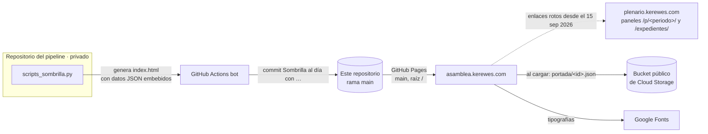

# asamblea.kerewes.com

Portada estática del proyecto de análisis de las actas del Plenario de la Asamblea Legislativa de Costa Rica,
publicada con GitHub Pages en <https://asamblea.kerewes.com>.

## Descripción

Página única que resume ocho periodos constitucionales del Plenario (de 1998–2002 a 2026–2030): votaciones, bancadas,
cambios de fracción, afinidad de voto, asistencia, lugares mencionados y personas e instituciones que concentran la
atención. Está dirigida al público general, periodistas e investigadores, y servía de puerta de entrada a los paneles
detallados de cada periodo.

**Este repositorio es un destino de publicación, no una fuente.** El contenido lo genera `scripts_sombrilla.py` en el
repositorio del pipeline de actas y un bot de GitHub Actions lo publica aquí en cada cambio. Editar `index.html` a
mano no sirve: el siguiente despliegue lo sobrescribe.

## Funciones

- Cifras globales del corpus (actas procesadas, votaciones, intervenciones, expedientes, horas de video enlazadas).
- Composición de la Asamblea por periodo y fichas de cada legislatura con su estado y métricas.
- Visualizaciones transversales: afinidad entre bancadas, curules y cambios de fracción, influencia en votaciones
  divididas, asistencia frente a postura registrada, mapa de lugares mencionados, atención comparada entre periodos.
- Sección de la legislatura en curso.
- Tema nocturno (por defecto) y diurno.
- Enlaces a los paneles por periodo y al buscador de expedientes (ver *Estado del proyecto*).

## Arquitectura



`index.html` es autocontenido: lleva el CSS, el JavaScript y los datos en un bloque
`<script id="datos" type="application/json">` con las claves `periodos` (ocho entradas con `id`, `nombre`, `actas`,
`estado`, `url`, `metricas`), `global`, `contorno`, `causas_archivo`, `leyes_parchadas` y `consultas_entidades`.

Al cargar, la página pide datos más recientes (`portada/<id>.json`) a un bucket público de Cloud Storage y los fusiona
sobre esa instantánea. Si el bucket no responde, se pinta con la instantánea embebida.

## Requisitos

Ninguno para verla: un navegador. Para revisarla localmente basta cualquier servidor estático.

## Inicio rápido

```bash
git clone https://github.com/Lapeyus/asamblea-sombrilla.git
cd asamblea-sombrilla
python3 -m http.server 8000
# abrir http://localhost:8000
```

## Estructura del repositorio

```text
.
├── index.html   # página completa generada (~1,4 MB, con los datos embebidos)
├── favicon.svg
├── autor.jpg    # foto de la sección de autoría
├── CNAME        # asamblea.kerewes.com
├── .nojekyll    # GitHub Pages sirve los archivos tal cual, sin Jekyll
└── README.md
```

## Configuración

No hay configuración en este repositorio. GitHub Pages publica desde `main`, carpeta raíz, con dominio propio
(`CNAME`) y HTTPS forzado.

## Pruebas

No hay pruebas aquí; la página se genera y valida en el repositorio del pipeline.

## Despliegue

Automático: cada commit del bot en `main` dispara la compilación de GitHub Pages. No hay workflow en este
repositorio; el push lo hace el pipeline.

## Estado del proyecto

Activo en modo publicación: 92 commits desde el 25 jul 2026, 91 de ellos del bot (`Sombrilla al día con …`); el último
es del 25 oct 2026.

### Estado conocido: plenario retirado

El sitio de paneles `plenario.kerewes.com` fue retirado el **15 sep 2026** y su nombre ya no resuelve. La portada lo
sigue enlazando, así que estos enlaces están **rotos**:

- los paneles por periodo `https://plenario.kerewes.com/p/<periodo>/` (de `1998_2002` a `2026_2030`), en las fichas
  de cada legislatura y en las secciones que abren un periodo;
- el buscador de expedientes `https://plenario.kerewes.com/expedientes/`.

El resto de la página (cifras, gráficos y textos) funciona porque sus datos van embebidos o llegan del bucket. La corrección corresponde
al generador del pipeline (quitar o redirigir esos enlaces), no a este repositorio.

### Otras limitaciones

- `index.html` pesa unos 1,4 MB por los datos embebidos; la primera carga es pesada en conexiones lentas.
- Depende de Google Fonts; las cifras más recientes dependen del bucket de Cloud Storage (con respaldo embebido).

## Licencia

Sin archivo de licencia.
